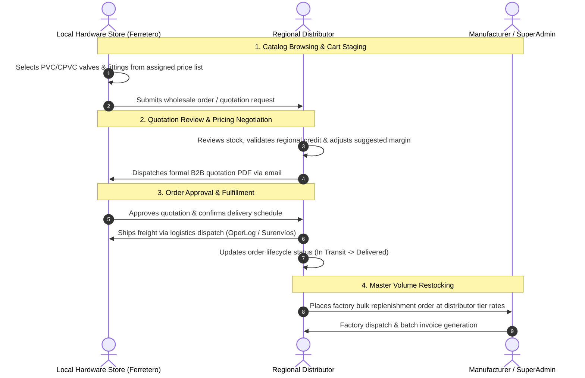
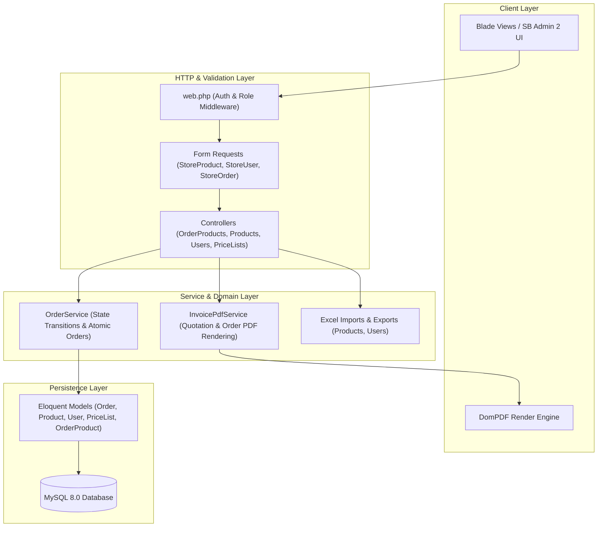

# PCP Industrial Wholesale E-Commerce & Supply Chain Platform

[](https://github.com/KevinAndrey96/pcp-industrial-wholesale-ecommerce/actions/workflows/ci.yml)
[](https://www.php.net/)
[](https://laravel.com/)
[](https://www.mysql.com/)
[](#architecture--design-patterns)
[](https://www.docker.com/)
[](LICENSE)

An enterprise-grade B2B distribution and wholesale supply chain platform developed for **PCP (Partes y Complementos Plásticos)**, an industrial manufacturing leader of thermoplastic valves, piping systems, hydraulic fittings, and plumbing solutions.

The platform orchestrates multi-tiered wholesale operations, connecting **Industrial Manufacturers**, **Regional Wholesale Distributors**, and **Local Hardware Stores (Ferreterías)** across Colombia and international markets.

---

## Table of Contents

- [Business Domain & Supply Chain Flow](#business-domain--supply-chain-flow)
- [Key Features](#key-features)
- [Architecture & Design Patterns](#architecture--design-patterns)
- [Multi-Tier Role Hierarchy](#multi-tier-role-hierarchy)
- [Tech Stack](#tech-stack)
- [Quickstart with Docker Compose](#quickstart-with-docker-compose)
- [Native Local Installation](#native-local-installation)
- [Default Demonstration Accounts](#default-demonstration-accounts)
- [Makefile Commands](#makefile-commands)
- [License](#license)

---

## Business Domain & Supply Chain Flow

Industrial manufacturers in the plumbing and fluid-handling sector operate under multi-tiered distribution models. Rather than fulfilling fragmented retail orders, the manufacturer empowers regional master distributors to supply local hardware stores while maintaining price controls, credit terms, and regional territory exclusivity.



---

## Key Features

- **Multi-Tiered Pricing Matrix:** Support for role-specific, territory-specific, and currency-specific price lists (COP for domestic networks, USD for international export lines).
- **Dynamic B2B Quotation Engine:** Ironmongers request price transfers; regional distributors adjust per-item suggested pricing and auto-generate legal PDF quotations.
- **DomPDF Document Pipeline:** High-fidelity, print-ready PDF generation for purchase orders (`ORD-*`) and commercial quotations (`COT-*`).
- **Transactional Integrity:** All multi-item checkout operations are wrapped within atomic database transactions with inventory auditing.
- **Bulk Catalog Management:** Full Excel import/export (`.xlsx`, `.csv`) for rapid catalog updates and batch user onboarding powered by `Maatwebsite/Laravel-Excel`.
- **Integrated Email Dispatch:** Transactional email triggers for order status updates, new quote alerts, and PDF document delivery.
- **Logistics Tracking Shortcuts:** Direct integrations with regional carrier portals (`OperLog`, `Surenvíos`).

---

## Architecture & Design Patterns

The codebase adheres to **Clean Architecture** and **SOLID** principles, decoupling business logic from HTTP transport and ORM persistence:



### Highlights of the Refactor
- **Service Layer Pattern:** `App\Services\OrderService` centralizes order calculation, role-based seller assignments, and status machine transitions.
- **Document Generation Service:** `App\Services\InvoicePdfService` encapsulates layout compilation and file streaming for DomPDF.
- **Eager Loading Optimization:** Eliminated N+1 query patterns across cart calculations, purchase order listings, and user association views using `with(['buyer', 'seller', 'items.product'])`.
- **Defensive Error Handling:** Replaced brittle array index access (`$orders[1]`) with safe collection methods.

---

## Multi-Tier Role Hierarchy

| Role | Access Level | Responsibilities |
|---|---|---|
| **Administrador** (Manufacturer) | Global / SuperAdmin | Manages global catalog, price lists, assigns users, audits all regional transfers and nationwide distributor performance. |
| **Distribuidor** (Master Distributor) | Regional Hub | Purchases wholesale volume directly from the factory, receives order transfer requests from ironmongers in their territory, issues custom quotations, and updates delivery tracking. |
| **Ferretero** (Hardware Store) | Local Retailer | Browses products assigned to their pricing tier, submits order transfers to regional distributors, downloads official PDF quotations, and tracks shipment arrival. |

---

## Tech Stack

- **Backend Framework:** Laravel 8.x
- **Runtime Environment:** PHP 8.1+
- **Relational Database:** MySQL 8.0 (InnoDB, Foreign Key Integrity)
- **Containerization:** Docker & Docker Compose
- **Document & Spreadsheet Generation:** `barryvdh/laravel-dompdf`, `maatwebsite/excel`
- **Frontend / Styling:** Blade, Bootstrap 4, SB Admin 2, FontAwesome 5
- **Local Email Testing:** Mailpit (`axllent/mailpit`)

---

## Quickstart with Docker Compose

Ensure Docker and Docker Compose are installed on your machine.

### 1. Automated Setup via Makefile
```bash
# Clone the repository
git clone git@github.com:KevinAndrey96/pcp-industrial-wholesale-ecommerce.git
cd pcp-industrial-wholesale-ecommerce

# Initialize environment, spin up containers, run migrations and seeds
make setup
```

### 2. Manual Docker Compose Execution
```bash
# Copy sample environment configuration
cp .env.example .env

# Build and start services in the background
docker compose up -d --build

# Install PHP dependencies & generate application key
docker compose exec app composer install
docker compose exec app php artisan key:generate

# Execute database migrations and seed realistic industrial data
docker compose exec app php artisan migrate --force
docker compose exec app php artisan db:seed --force
```

- **Application URL:** [http://localhost:8000](http://localhost:8000)
- **Mailpit Web UI (Email Inbox):** [http://localhost:8025](http://localhost:8025)

---

## Native Local Installation

If running outside Docker:

```bash
# 1. Install Composer dependencies
composer install

# 2. Configure environment file
cp .env.example .env
php artisan key:generate

# 3. Configure your MySQL credentials in .env and run migrations
php artisan migrate --force
php artisan db:seed --force

# 4. Start local development server
php artisan serve
```

---

## Default Demonstration Accounts

The database seeder initializes 3 operational accounts to test the entire multi-tier supply chain:

| Role | Email Address | Password | Pricing Tier |
|---|---|---|---|
| **Administrador** | `admin@pcp-industrial.com` | `PCPIndustrial2026!` | SuperAdmin Privileges |
| **Distribuidor** | `distribuidor.andina@pcp-industrial.com` | `PCPIndustrial2026!` | Lista Distribuidores Nacional |
| **Ferretero** | `ferreteria.central@pcp-industrial.com` | `PCPIndustrial2026!` | Lista Ferreteros Andina |

---

## Makefile Commands

| Command | Description |
|---|---|
| `make setup` | Automated first-time project setup (containers + db + seed) |
| `make up` | Start Docker containers in detached mode |
| `make down` | Stop running containers |
| `make restart` | Restart all services |
| `make logs` | Stream application and database logs |
| `make app-bash` | Open shell inside the Laravel PHP container |
| `make mysql-bash` | Open interactive MySQL client inside database container |
| `make migrate` | Run pending database migrations |
| `make seed` | Populate database with realistic valve/pipe industrial catalog |
| `make fresh` | Drop all database tables, re-migrate, and re-seed |
| `make lint` | Run PHP syntax validator across all project directories |

---

## License

This project is open-source software licensed under the [MIT License](LICENSE).
