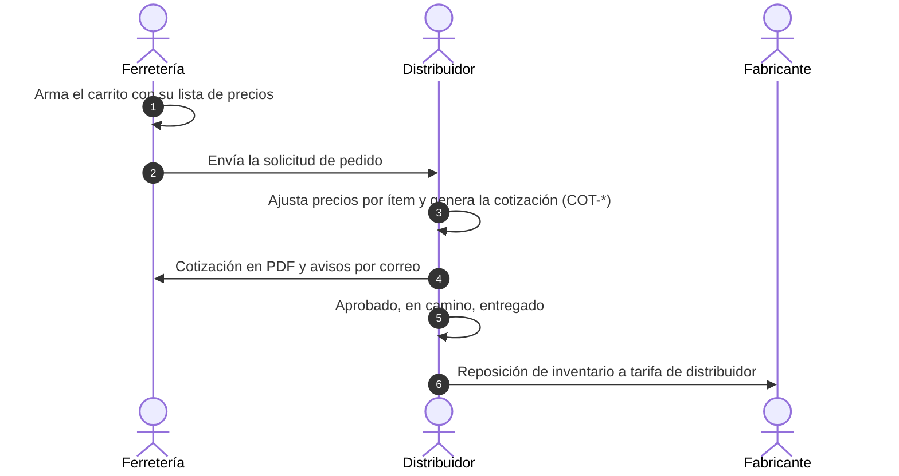
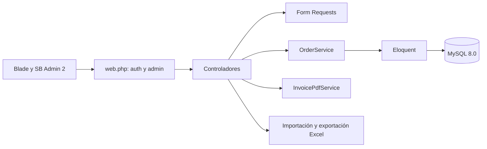

# Plataforma B2B de distribución mayorista PCP (Laravel)

[](https://github.com/KevinAndrey96/laravel-pcp-industrial-wholesale-ecommerce/actions/workflows/ci.yml)


Plataforma B2B para **PCP (Partes y Complementos Plásticos)**, fabricante de válvulas, tubería y accesorios termoplásticos. Conecta al fabricante con distribuidores regionales y ferreterías de Colombia, Perú y México: cada actor ve el catálogo con su lista de precios, las ferreterías solicitan pedidos a su distribuidor, el distribuidor cotiza y gestiona el estado del pedido, y el fabricante administra catálogo, listas y usuarios.

Proyecto desarrollado para un cliente. El repositorio se publica como muestra de portafolio.

## Flujo de un pedido



## Funcionalidades

- **Listas de precios por rol y moneda** (por ejemplo COP y USD) asignadas a cada usuario; las ferreterías se registran solas y reciben la lista de ferreteros de la moneda de su país (COP, PEN o MXN) si existe.
- **Pedidos y cotizaciones**: el carrito se valida y se guarda en una transacción (`OrderService`), el vendedor ajusta precios y mueve el pedido por estados (iniciado, pendiente, aprobado, en camino, entregado, rechazado, devolución) con notificación por correo.
- **Documentos PDF** de orden de compra (`ORD-*`) y cotización (`COT-*`) con DomPDF (`InvoicePdfService`).
- **Catálogo y usuarios en Excel**: importación y exportación con Maatwebsite Excel.
- **Accesos directos** a los portales de transportadoras (OperLog y Surenvíos).

## Roles y acceso

| Rol | Puede |
| :--- | :--- |
| **Administrador** (fabricante) | Usuarios, listas de precios, productos, importación y exportación, todas las órdenes y transferencias. |
| **Distribuidor** | Su catálogo, pedidos a fábrica, las solicitudes de sus ferreterías, cotizaciones y estados de esas órdenes. |
| **Ferretero** | Su catálogo, solicitudes de pedido y el detalle y PDF de sus propias órdenes. |

El back office está detrás del middleware `admin`, y una orden solo la pueden ver su comprador, su vendedor o un administrador; cotizar y cambiar el estado queda reservado al vendedor y al administrador.

## Arquitectura



## Desarrollo local

Requisitos: Docker con Compose v2, o PHP 8.0/8.1, Composer y MySQL 8.

```bash
make setup   # copia .env, construye la imagen, levanta los servicios, migra y siembra
make up
make help    # resto de comandos (logs, test, lint, fresh...)
```

La aplicación queda en `http://localhost:8000` y Mailpit en `http://localhost:8025`. Las semillas crean un catálogo de tubería y válvulas y una cuenta por rol:

| Rol | Correo | Contraseña |
| :--- | :--- | :--- |
| Administrador | `admin@example.com` | `AdminPassword123!` |
| Distribuidor | `distribuidor@example.com` | `DistribuidorPass123!` |
| Ferretero | `ferretero@example.com` | `FerreteroPass123!` |

## Calidad y CI

GitHub Actions ejecuta en cada push y pull request:

- `composer validate --strict` y **Laravel Pint**.
- Migraciones y semillas sobre MySQL 8 y **PHPUnit** en PHP 8.0 y 8.1: rutas protegidas, back office solo para administradores, órdenes visibles solo para sus partes, cotización y estados solo para el vendedor y registro de ferreterías con datos completos.
- Validación de `docker-compose.yml`, construcción de la imagen y arranque de Artisan dentro del contenedor.

```bash
vendor/bin/pint --test
vendor/bin/phpunit
```

## Licencia

Sin licencia de código abierto. Este código pertenece a un proyecto de cliente y se publica únicamente como muestra de portafolio; todos los derechos reservados.
